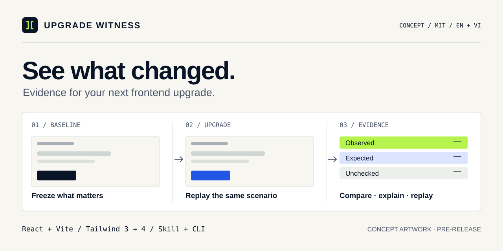

<p align="center"><a href="README.md">English</a> · <a href="README.vi.md">Tiếng Việt</a></p>

# Upgrade Witness

**Upgrade your dependencies. See what changed.**

A native Rust CLI and AI skill that compare two committed frontend revisions and produce reviewable evidence. The first workflow targets **React + Vite, npm, Tailwind 3 → 4 and Chromium**.



[](https://github.com/2274802010922/upgrade-witness/actions/workflows/ci.yml)
**v0.2.0-alpha.1 · Native Rust** · [MIT](LICENSE) · [Roadmap](docs/ROADMAP.en.md) · [Contribute](CONTRIBUTING.md)

## Run the synthetic migration demo

Build prerequisites: a current stable Rust toolchain with Cargo and the platform's linker/build tools. Windows users of Rust's MSVC toolchain also need the Visual C++ Build Tools. Runtime prerequisites: Git and an installed Chrome/Chromium browser. **The CLI does not need Node.js, npm or Playwright to run.** Node.js and npm are needed to install, build and serve the target React/Vite application, including this demo. See [Rust's Windows setup notes](https://rust-lang.github.io/rustup/installation/windows.html).

```sh
git clone https://github.com/2274802010922/upgrade-witness.git
cd upgrade-witness
cargo build --locked
cargo run --locked -- doctor
cargo run --locked -- demo
```

`doctor` checks Git and actually launches the browser. Chrome/Chromium is detected locally; set `UW_BROWSER_EXECUTABLE` to a trusted browser executable if detection fails. No browser downloader or Node-based browser driver is required. See [platform setup and commands](docs/USAGE.md).

The demo creates an isolated Git repository with original synthetic Tailwind 3 and Tailwind 4 states. It deliberately loses a column configuration and changes a `data-variant`. The verifier should detect both assertion regressions; the demo command returns success only when those expected findings are present and no assertion checkpoints are missing. Visual differences remain review items, so a successful demo can report `complete:false`.

The command prints the generated report location. [See the actual Rust demo report and observations](docs/cases/tailwind-demo.md), or inspect [the fixture and its provenance](examples/tailwind-migration/README.md). This example does not measure real-world accuracy or the behavior of today's official Tailwind migrator.

## Use it with your agent

Make [the skill folder](skills/upgrade-witness/SKILL.md) available through your agent's documented skill mechanism, or ask the agent to read its entrypoint. The skill uses a separately built `uw` binary or this Cargo checkout. It does not install a model, register an MCP server, or grant permissions.

> Use Upgrade Witness to verify this Tailwind migration. Preserve the navigation and layout behavior we specify. Show reproducible findings and anything you could not verify.

Your agent can help perform an authorized migration with official tools. The Rust CLI verifies committed revisions; it does not migrate or merge your application.

## Verify your project

Start from [the example configuration](examples/tailwind-migration/witness.config.json). Define expectations from the baseline and your requirements before inspecting candidate outcomes. Both revisions need `package.json`, `package-lock.json`, and an npm development script accepting Vite's host/port flags.

```sh
cargo run --locked -- verify --repo "/path/to/trusted-app" --base BASE_COMMIT --head HEAD_COMMIT --config "/path/to/witness.config.json" --out ".uw/my-first-run" --trust-project
```

Replace the paths and commit placeholders. Use quotes for Windows paths with spaces. `--out` must be new. `--trust-project` acknowledges execution of the selected project's installation, build and start scripts within your authorized task.

For direct use, `cargo build --locked --release` produces `target/release/uw` on Unix or `target\release\uw.exe` on Windows. The binary accepts the same subcommands and flags.

The verifier resolves full commit SHAs, creates detached worktrees, captures each side twice on the same local origin, and writes HTML, Markdown and JSON reports with screenshots and evidence hashes. It excludes and preserves uncommitted source changes. [Configuration and interpretation](docs/USAGE.md)

| Exit | Meaning |
|---|---|
| `0` | Required verification completed without regressions or unresolved differences |
| `1` | At least one repeatable assertion regression; unresolved findings may coexist |
| `2` | Inconclusive verification, baseline instability, infrastructure failure or visual review; also an unsuccessful `doctor` check |
| `64` | Invalid command/configuration or an error before a verification report can be produced |

Read `complete` and coverage alongside the exit code. A regression can coexist with `complete:false`. A screenshot difference is a review item, not automatic proof of a bug.

## What the Rust alpha implements

- Pinned detached revision worktrees, npm lockfile installs, optional builds and bounded server startup.
- CSS-selector actions for clicking, filling and pressing keys; visibility, trimmed text, attribute and computed-style assertions.
- Repeated baseline/candidate observations, explicit intended changes and same-environment screenshot comparison.
- Static HTML/Markdown/JSON evidence reports, sanitized text and SHA-256 artifact hashes.
- A synthetic migration demo and Rust tests for comparison, reports, CLI, workspaces and browser interactions.

Pixel comparison counts a pixel as changed when any RGBA channel differs by more than 25 out of 255, then compares the changed-pixel fraction with `maxDiffPixelRatio`. This is a small deterministic threshold, not a claim of production-grade visual-diff precision.

## Boundaries that matter

Only declared routes, states and assertions are checked. The runner fixes viewport, device scale, locale, timezone, color scheme and reduced motion; it does not freeze clocks, random values, live data or font assets. Use deterministic fixtures and the same browser version. A narrow viewport is not full mobile-device emulation. Unsupported or unavailable navigation status is inconclusive. Next.js/SSR, monorepos, pnpm, MCP and production automation are outside this alpha.

Use synthetic non-sensitive data. Screenshots mask input fields, editable regions and configured selectors, but other page content and assertion values may still be private. Token filtering is best effort; review all artifacts before sharing. The CLI makes no model calls or uploads, while your agent may send context to its provider. Worktrees are not security sandboxes; deliberately detached daemons may escape process cleanup.

Independent held-out evaluation and external pilots are **not yet completed**. The [evaluation protocol](docs/BENCHMARK.en.md) contains targets, not measured performance claims. The [Rust architecture update](docs/RUST-MIGRATION.md) describes the implementation decision; [status](docs/STATUS.md) separates verified local work from pending checks.

## Build with us

Contribute a minimal migration case, a clean control, an assertion, a report improvement or an English/Vietnamese correction. Read [CONTRIBUTING](CONTRIBUTING.md).

[Architecture](docs/ARCHITECTURE.en.md) · [Bilingual backlog](docs/BACKLOG.md) · [GitHub presentation plan](docs/GITHUB.en.md) · [Security](SECURITY.md)

[Native Rust architecture](docs/RUST-MIGRATION.md) · [Tiếng Việt](docs/RUST-MIGRATION.vi.md)

[Repository social preview artwork · 1280 × 640](assets/social-card-rust-alpha.png)

[MIT](LICENSE) · Copyright (c) 2026 Upgrade Witness contributors. Third-party material retains its applicable terms.
