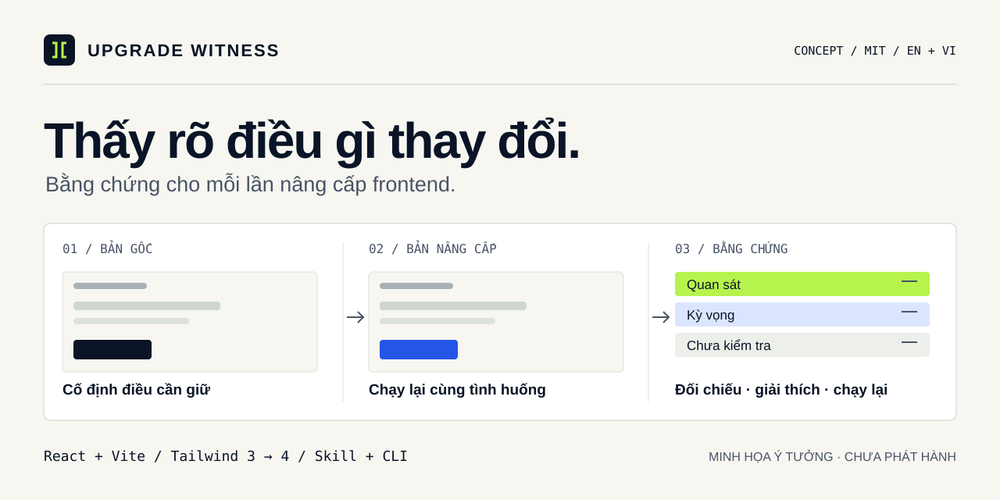

<p align="center"><a href="README.md">English</a> · <a href="README.vi.md">Tiếng Việt</a></p>

# Upgrade Witness

**Nâng cấp thư viện. Thấy rõ điều gì thay đổi.**

CLI native Rust và skill AI đối chiếu hai revision frontend đã commit, tạo bằng chứng có thể review. Luồng đầu tiên tập trung vào **React + Vite, npm, Tailwind 3 → 4 và Chromium**.



[](https://github.com/2274802010922/upgrade-witness/actions/workflows/ci.yml)
**v0.2.0-alpha.1 · Native Rust** · [MIT](LICENSE) · [Roadmap](docs/ROADMAP.vi.md) · [Đóng góp](CONTRIBUTING.vi.md)

## Chạy demo migration tổng hợp

Để build, cần Rust stable hiện hành, Cargo và linker/công cụ build của hệ điều hành. Khi chạy, cần Git và Chrome/Chromium đã cài. **Bản thân CLI không cần Node.js, npm hay Playwright.** Node.js và npm dùng để cài, build và phục vụ ứng dụng React/Vite được kiểm tra, bao gồm demo này.

```sh
git clone https://github.com/2274802010922/upgrade-witness.git
cd upgrade-witness
cargo build --locked
cargo run --locked -- doctor
cargo run --locked -- demo
```

`doctor` kiểm tra Git và thực sự mở trình duyệt. Công cụ tự tìm Chrome/Chromium local; đặt `UW_BROWSER_EXECUTABLE` tới binary trình duyệt tin cậy nếu không tìm được. Không cần bộ tải trình duyệt hoặc driver chạy bằng Node. Xem [thiết lập nền tảng và lệnh](docs/USAGE.md).

Demo tạo repo Git riêng với hai trạng thái Tailwind 3 và Tailwind 4 tự xây dựng. Nó cố ý làm mất cấu hình cột và đổi `data-variant`. Bộ kiểm chứng phải tìm được cả hai assertion regression; lệnh demo chỉ trả thành công khi có các phát hiện mong đợi và không thiếu checkpoint assertion. Khác biệt ảnh vẫn cần review, nên demo thành công có thể có `complete:false`.

Lệnh in vị trí báo cáo. [Xem báo cáo Rust demo và quan sát thực tế](docs/cases/tailwind-demo.md), hoặc đọc [fixture và nguồn gốc](examples/tailwind-migration/README.md). Ví dụ này chưa đo độ chính xác ngoài thực tế hay hành vi của migrator Tailwind chính thức hiện tại.

## Dùng cùng agent

Đưa [thư mục skill](skills/upgrade-witness/SKILL.md) vào cơ chế skill mà agent hỗ trợ, hoặc yêu cầu agent đọc entrypoint. Skill dùng binary `uw` đã build riêng hoặc checkout Cargo này. Nó không cài model, đăng ký MCP server hay cấp quyền.

> Dùng Upgrade Witness kiểm chứng lần nâng Tailwind này. Giữ hành vi điều hướng và bố cục đã xác định. Đưa bằng chứng chạy lại được và nêu phần chưa kiểm chứng.

Agent có thể hỗ trợ migration được giao bằng công cụ chính thức. CLI Rust kiểm chứng revision đã commit; nó không tự migration hay merge ứng dụng.

## Kiểm tra project của bạn

Bắt đầu từ [cấu hình mẫu](examples/tailwind-migration/witness.config.json). Xác định kỳ vọng từ bản gốc và yêu cầu trước khi đọc kết quả candidate. Cả hai revision cần `package.json`, `package-lock.json` và npm script chạy dev nhận các cờ host/port của Vite.

```sh
cargo run --locked -- verify --repo "/path/to/trusted-app" --base BASE_COMMIT --head HEAD_COMMIT --config "/path/to/witness.config.json" --out ".uw/my-first-run" --trust-project
```

Thay đường dẫn và commit mẫu bằng giá trị thật. Đặt đường dẫn Windows có dấu cách trong ngoặc kép. `--out` phải là thư mục mới. `--trust-project` xác nhận việc chạy script cài đặt, build và khởi động của project đã chọn trong phạm vi được giao.

Muốn chạy trực tiếp, `cargo build --locked --release` tạo `target/release/uw` trên Unix hoặc `target\release\uw.exe` trên Windows. Binary nhận cùng subcommand và cờ.

Bộ kiểm chứng chốt SHA đầy đủ, tạo detached worktree, chạy mỗi bên hai lần trên cùng origin local, rồi xuất báo cáo HTML, Markdown, JSON cùng ảnh và hash bằng chứng. Thay đổi chưa commit được loại khỏi đầu vào và giữ nguyên. [Cấu hình và cách đọc kết quả](docs/USAGE.md)

| Mã thoát | Ý nghĩa |
|---|---|
| `0` | Kiểm chứng hoàn thành, không có regression hoặc khác biệt chưa xử lý |
| `1` | Có ít nhất một assertion regression lặp lại được; có thể còn phát hiện chưa giải quyết |
| `2` | Chưa kết luận, baseline bất ổn, lỗi hạ tầng hoặc ảnh cần review; cũng dùng khi `doctor` chưa đạt |
| `64` | Lệnh/cấu hình không hợp lệ hoặc lỗi trước khi tạo được báo cáo kiểm chứng |

Đọc `complete` và coverage cùng mã thoát. Regression có thể đi cùng `complete:false`. Ảnh khác nhau là mục cần review, chưa tự chứng minh có bug.

## Alpha Rust đã triển khai gì

- Detached worktree theo revision cố định, cài bằng npm lockfile, build tùy chọn và giới hạn thời gian khởi động server.
- Thao tác click, fill và nhấn phím bằng CSS selector; assertion visibility, text đã trim, attribute và computed style.
- Quan sát lặp lại trên baseline/candidate, thay đổi có chủ đích và so ảnh trong cùng môi trường.
- Báo cáo bằng chứng HTML/Markdown/JSON tĩnh, lọc dữ liệu dạng text và hash SHA-256 cho artifact.
- Demo migration tổng hợp và Rust test cho so sánh, báo cáo, CLI, workspace, tương tác trình duyệt.

So ảnh tính một pixel là thay đổi khi bất kỳ kênh RGBA nào lệch quá 25 trên 255, rồi so tỷ lệ pixel khác với `maxDiffPixelRatio`. Đây là ngưỡng xác định nhỏ gọn, không phải cam kết độ chính xác tổng quát.

## Giới hạn cần biết

Chỉ kiểm tra route, trạng thái và assertion đã khai báo. Runner cố định viewport, device scale, locale, múi giờ, chế độ màu và reduced motion; chưa đóng băng clock, số ngẫu nhiên, dữ liệu live hoặc font. Dùng fixture ổn định và cùng phiên bản trình duyệt. Viewport hẹp chưa phải giả lập đầy đủ thiết bị di động. Nếu không đọc được HTTP navigation status phù hợp thì kết quả chưa thể kết luận. Next.js/SSR, monorepo, pnpm, MCP và tự động hóa production nằm ngoài alpha.

Dùng dữ liệu giả không nhạy cảm. Ảnh che input, vùng chỉnh sửa và selector cấu hình, nhưng nội dung khác và giá trị assertion vẫn có thể riêng tư. Lọc token chỉ là biện pháp hỗ trợ; xem lại artifact trước khi chia sẻ. CLI không gọi model hoặc upload; agent có thể gửi ngữ cảnh tới nhà cung cấp của nó. Worktree không phải sandbox bảo mật; daemon cố ý tách tiến trình có thể thoát cơ chế dọn dẹp.

Đánh giá giữ kín độc lập và pilot bên ngoài **chưa hoàn thành**. [Quy trình đánh giá](docs/BENCHMARK.vi.md) là mục tiêu, chưa phải thành tích đã đo. [Cập nhật kiến trúc Rust](docs/RUST-MIGRATION.md) mô tả quyết định triển khai; [trạng thái](docs/STATUS.md) phân biệt việc đã kiểm local với bước còn lại.

## Cùng phát triển

Đóng góp ca migration nhỏ, ca đối chứng sạch, assertion, cải thiện báo cáo hoặc bản sửa Anh–Việt. Đọc [CONTRIBUTING](CONTRIBUTING.vi.md).

[Kiến trúc](docs/ARCHITECTURE.vi.md) · [Backlog song ngữ](docs/BACKLOG.md) · [Kế hoạch GitHub](docs/GITHUB.vi.md) · [Bảo mật](SECURITY.md)

[Kiến trúc Rust native](docs/RUST-MIGRATION.vi.md) · [English](docs/RUST-MIGRATION.md)

[Ảnh social preview GitHub · 1280 × 640](assets/social-card-rust-alpha.png)

[MIT](LICENSE) · Copyright (c) 2026 Upgrade Witness contributors. Thành phần bên thứ ba giữ điều khoản tương ứng.
