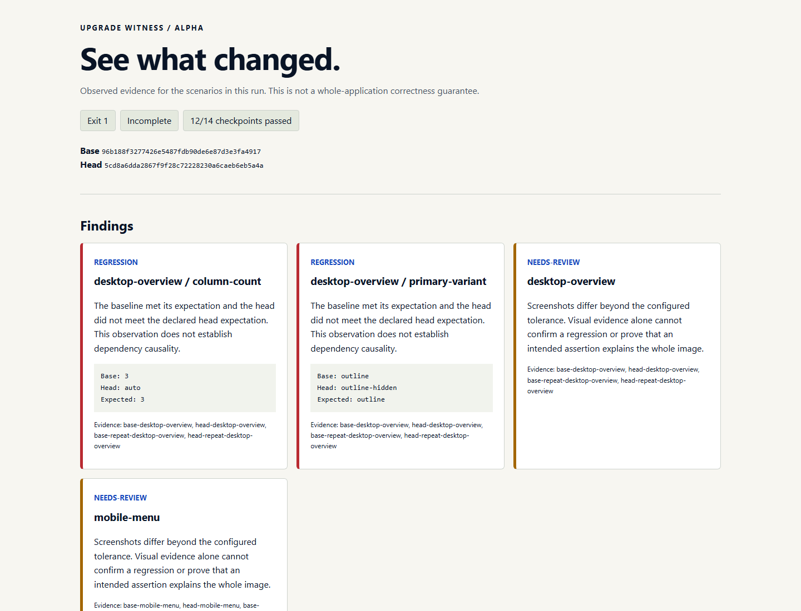

# A synthetic Tailwind migration, observed end to end

[English](../../README.md) · [Tiếng Việt](../../README.vi.md) · Recorded / Ghi nhận: 16 October 2026

This is an original positive-control fixture, deliberately authored with two defects. It is not held-out evaluation, a third-party testimonial, or a claim about the current Tailwind migrator. / Đây là ca đối chứng tự tạo, cố ý có hai lỗi; không phải đánh giá giữ kín hoặc thành tích của công cụ nâng cấp Tailwind hiện tại.



## Observations / Quan sát

| Check / Phép kiểm | Baseline / Bản gốc | Candidate / Bản mới | Result / Kết quả |
|---|---|---|---|
| Desktop computed `column-count` | `3` | `auto` | Confirmed assertion regression / Regression assertion |
| Primary action `data-variant` | `outline` | `outline-hidden` | Confirmed assertion regression / Regression assertion |
| Four mobile menu/layout assertions | Passed / Đạt | Passed / Đạt | No assertion regression / Không regression assertion |
| Desktop and mobile screenshots | Stable across repeats / Ổn định qua lượt lặp | Changed / Khác bản gốc | Needs review / Cần review |

All **14 assertion checkpoints** executed: **12 passed, 2 failed, 0 not run**. Each side was captured twice for stability. The verifier returned **1** because of confirmed assertion regressions, with **`complete:false`** because visual differences remained unresolved. The demo wrapper returned **0**, correctly accepting that expected positive-control outcome.

Đã chạy đủ **14 checkpoint**: **12 đạt, 2 lỗi, 0 bỏ qua**. Mỗi bên chạy hai lần để kiểm ổn định. Verifier trả **1**, `complete:false` vì còn ảnh cần review. Script demo trả **0** vì đã phát hiện đúng lỗi cố ý tạo ra.

Environment: Windows x64, Node 24.16.0, Playwright 1.64.1, Chromium 156.0.8078.4. Fixture dependencies are pinned in its lockfiles. The demo creates its own temporary commits; those SHAs identify local fixture revisions, not release commits in this repository.

## Replay / Chạy lại

```sh
npm ci
npx playwright install chromium
npm run demo
```

The command prints the new report path under `.uw/demo-reports/`. Open `report.html` and inspect `report.json`, `inputs.json` and the hashed evidence. Use the [fixture README](../../examples/tailwind-migration/README.md) to inspect the deliberately changed code.

Lệnh in đường dẫn báo cáo mới. Xem HTML, JSON, đầu vào và hash bằng chứng. README fixture giải thích thay đổi cố ý tạo. Clock/network/randomness are not automatically frozen; this fixture uses stable local content. / Fixture dùng nội dung local ổn định vì runner chưa tự đóng băng dữ liệu động.

The first attempted run began before the browser installation finished and was correctly marked inconclusive. The successful run above followed completed browser setup. / Lượt thử đầu khi browser chưa cài xong được báo chưa kết luận; số liệu trên thuộc lượt sau khi setup hoàn tất.
